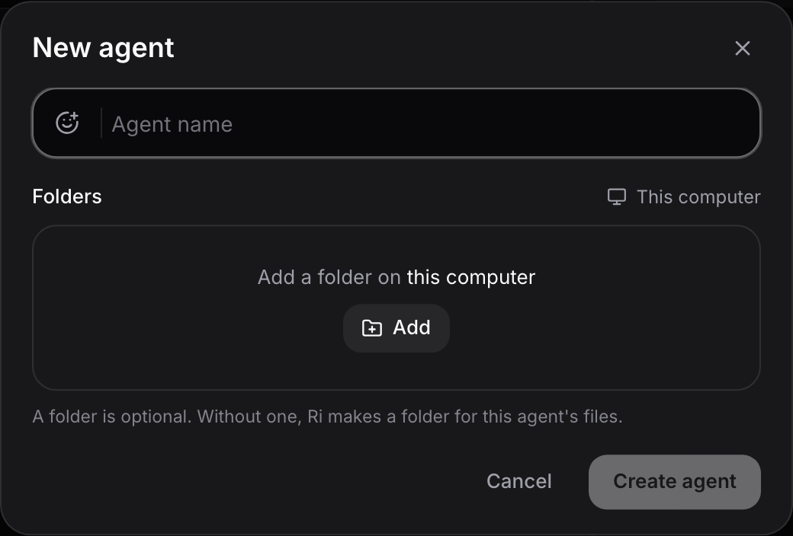
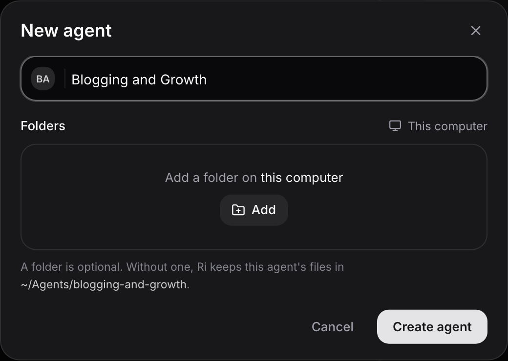
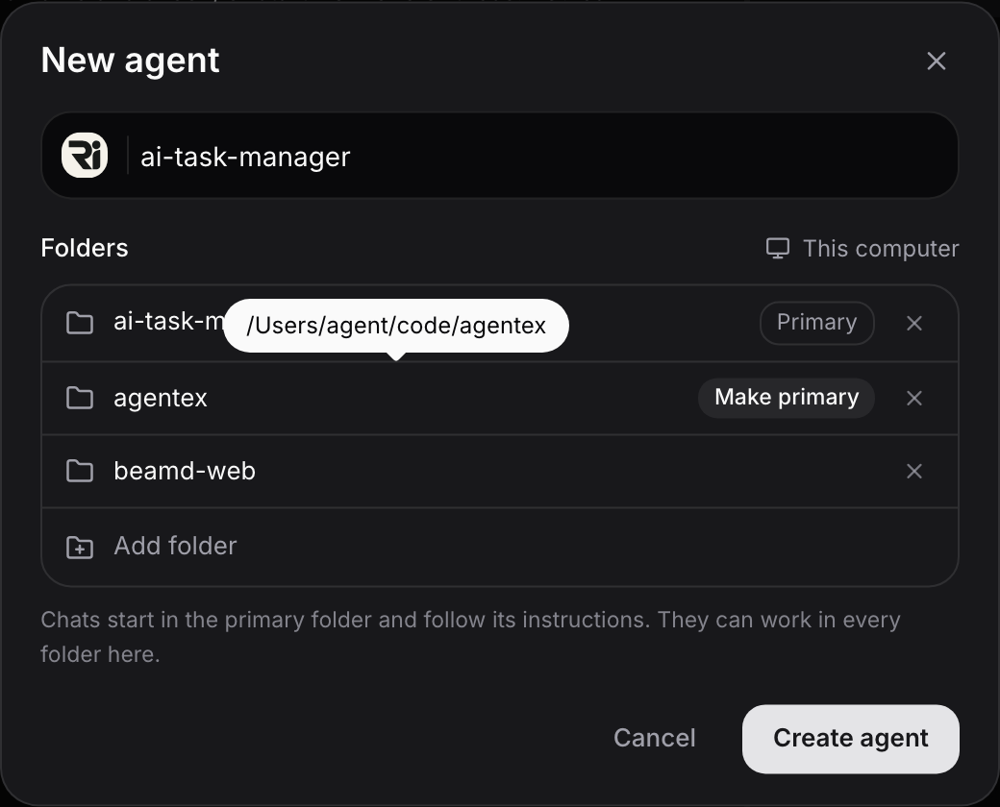
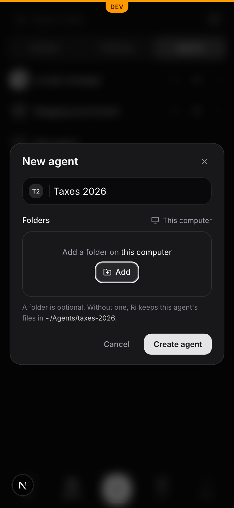
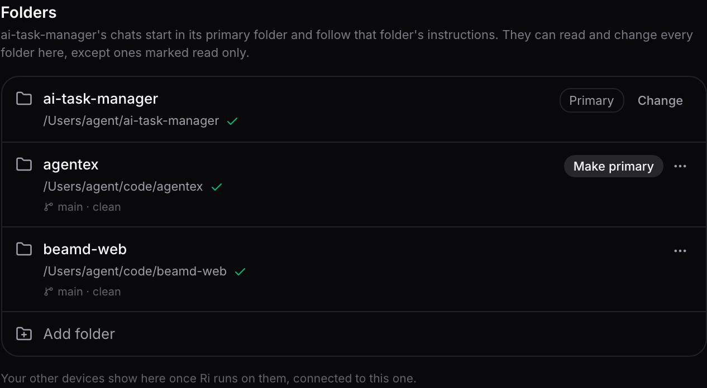
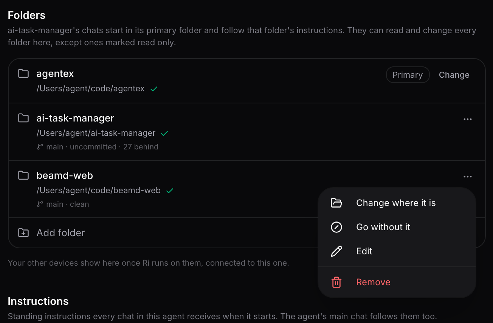
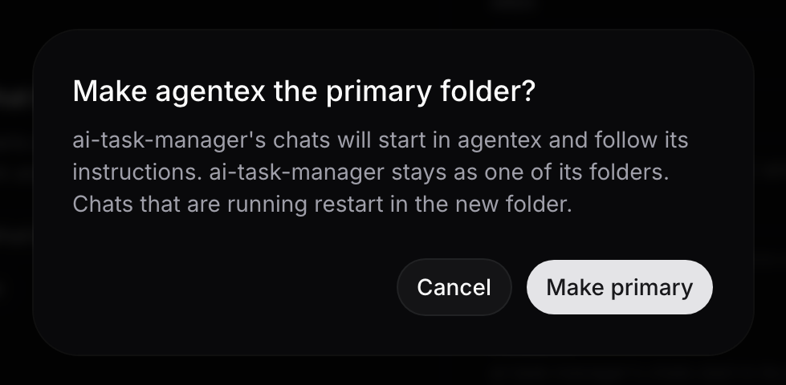
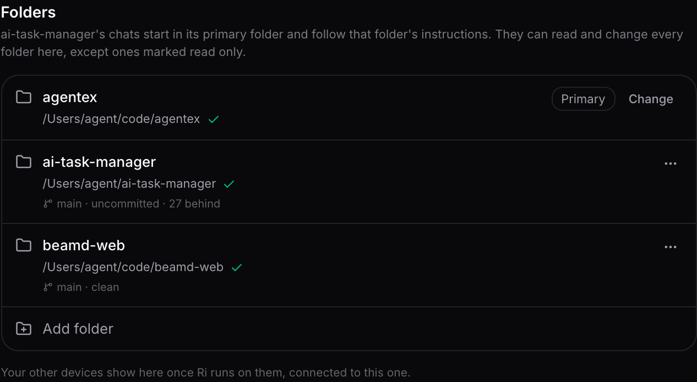
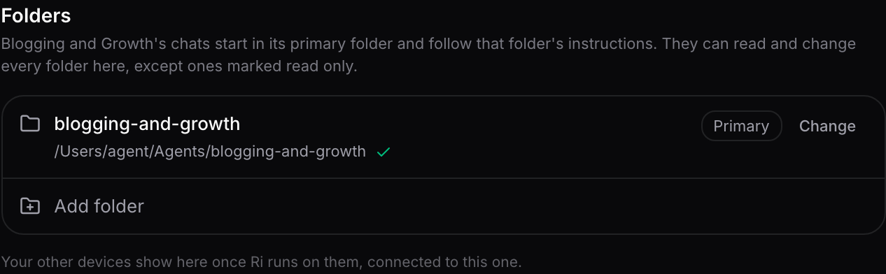

# Agent folders

Status: built 2026-11-16 on `ai-task-manager/agent-folders`, as a trial for Trey to try on dev.

## The model

An agent works in one or more folders, shown as one list, the way ChatGPT shows a project's folders.

- **The primary folder** is where its chats start, whose `AGENTS.md` / `CLAUDE.md`, skills and config they follow, where its worktrees come from, and what harnesses key their memory and transcripts by. Every running agent needs exactly one, so this is a fact about how the engines work, not a design choice. ChatGPT has the same thing (its docs: "New chats start in the primary folder"), behind a **Make primary** button.
- **Other folders** are folders it also works in. Chats can read and change them unless one is marked read only. These are the rows of `reference_folders` (the UI used to call them linked folders, and still does in a few places). A folder that is another agent's primary folder links that agent, so it follows that agent's folder on every device.
- **No folder** is allowed. Work like writing, research or admin doesn't live anywhere yet, so Ri makes the agent a plain folder named after it (`src/lib/workspaces/made-folder.ts`) and says where in the New agent dialog. The person never has to pick their home folder to get past the dialog, which is how an agent once ended up scanning 6.4M files and taking prod down.

Nothing in the schema changed. `workspaces.cwd` (and the home's `workspace_setups.source_path`) is still the primary folder and still required. Ri fills it.

## Where Ri makes folders

`getAgentFoldersDir()` in `src/lib/config/paths.ts`:

| Home | Folder for "Blogging and Growth" |
|---|---|
| Production (`~/ri`) | `~/Agents/blogging-and-growth` |
| Any other (`~/ri-dev`, a team, `/tmp/x`) | `<home>-agents/blogging-and-growth` |
| `RI_AGENTS_DIR` set | `$RI_AGENTS_DIR/blogging-and-growth` |

Never inside the home: the home has its own `AGENTS.md` (the app main chat's brief), and harnesses read instruction files from parent folders, so an agent folder inside it would pick up Ri's own brief. A name already used by a folder with something in it gets `-2`, `-3` and so on, so a new agent never moves into an old agent's files. An empty one is reused. The folder is plain, not a git repository, so chats run in it directly (the non-git path that already existed).

The nightly backup (`pnpm backup`) covers the home only, so these folders aren't in it, the same as any project folder a person picks.

## Creating an agent

`src/components/workspaces/workspace-create-modal.tsx`. A name, with the icon beside it, and a Folders list:

- Empty: "Add a folder on this computer" (or the Ri computer's name when the page runs elsewhere) and the line saying where Ri will keep the agent's files instead.
- With folders: each row shows the folder's name (the whole path on hover), **Primary** on the first, **Make primary** on the others (on hover, always on touch screens), and remove. **Add folder** at the bottom opens the folder browser.
- The name and icon follow the primary folder until the person sets them.

Everything else (connectors, browser, worktree scripts, files to copy, area) keeps its default and lives in the agent's Setup. One request creates it: `workspaces.create` takes `cwd` (optional) and `folders` (more folders), checks every folder before anything is made, and takes back a folder it made if creating fails. `ri agent create_workspace` takes the same two.

## Changing an agent's folders

Setup → Folders (`src/components/agents/agent-folders.tsx`), now right after Basics. One list per device:

- The primary folder first, with **Primary** and **Change**.
- Every other folder with **Make primary** (only the agent's own folders, placed on this device), and a menu: change or choose where it is, go without it on this device, name, notes and read only, remove.
- **Add folder** opens the folder browser and adds it named after itself (`linkFolder`). The old dialog with an alias and description is still there for a device that isn't running Ri (its path has to be typed) and through the menu's name and notes item.

**Make primary** (`makeLinkedFolderPrimary`, `POST workspaces/:id/folders/primary`, `ri agent make_primary_folder <agent> <alias>`) swaps the two on every device the agent is set up on. The old primary stays as a folder named after itself, editable. Git facts follow the new primary (`recordAgentFolder`). Running chats restart into it. It refuses a folder that is another agent's or every agent's, and one that has no place yet on a device the agent is on (it names the device), and checks every place before it changes anything.

## Screenshots

Taken 2026-11-16 on a throwaway home from this branch.

| | |
|---|---|
| New agent, empty |  |
| A name and no folder |  |
| Three folders, hovering the second |  |
| On a phone |  |
| Setup, Folders |  |
| A folder's menu |  |
| Make primary |  |
| After Make primary |  |
| An agent made without a folder |  |

## Known gaps

- A Claude chat's transcript is stored under the folder it ran in, so after the primary folder changes (Make primary, or Change), the agent's main chat may not resume its old conversation. This was already true of Change. Not handled here.
- Other folders are shared live by all of an agent's chats: only the primary folder gets a worktree per chat. ChatGPT has the same gap. Per-chat worktrees for every git folder a chat writes to would be the fix if collisions show up.
